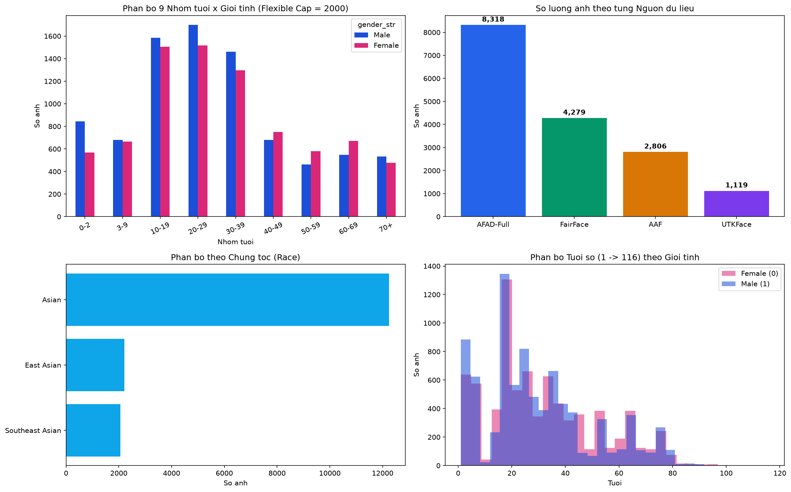
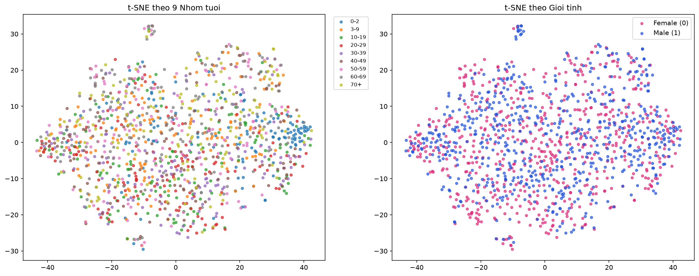
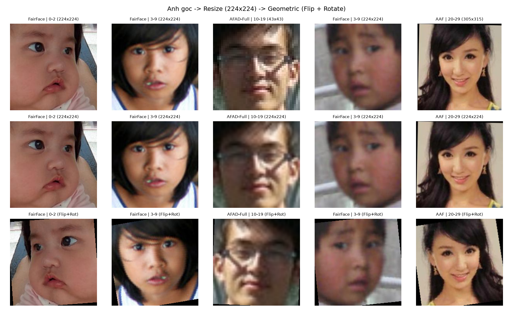
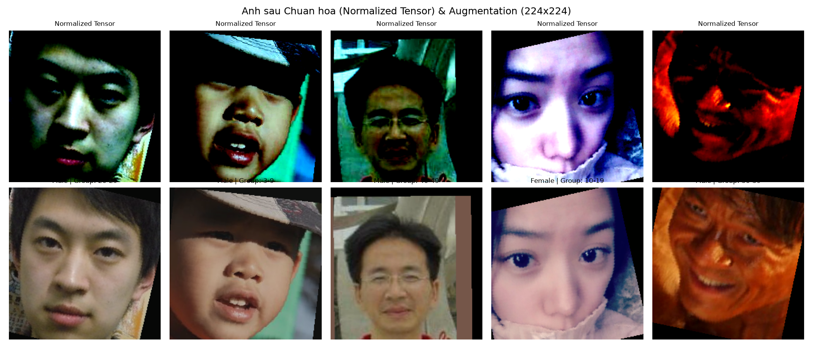
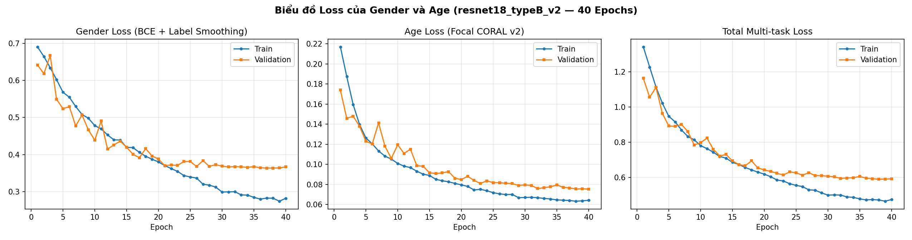
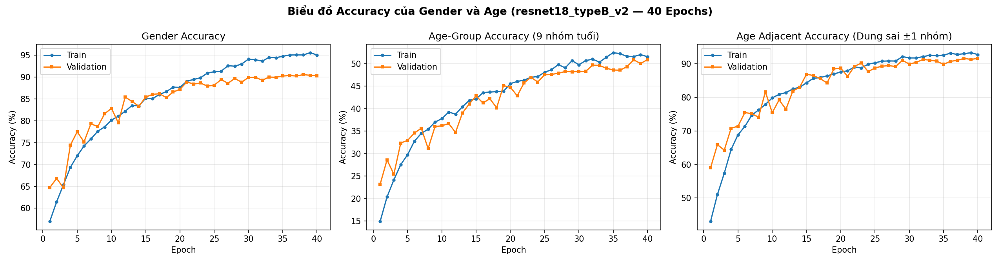
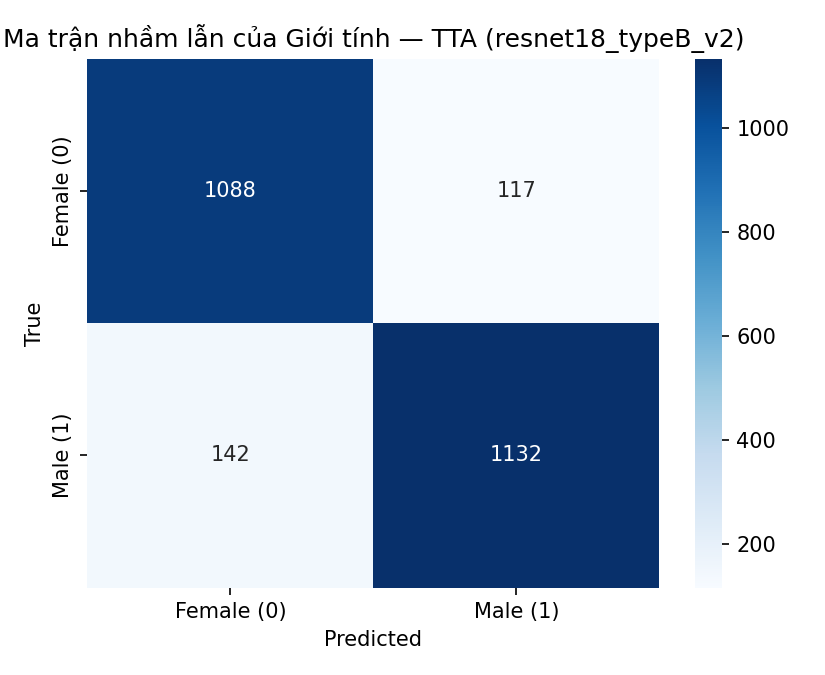
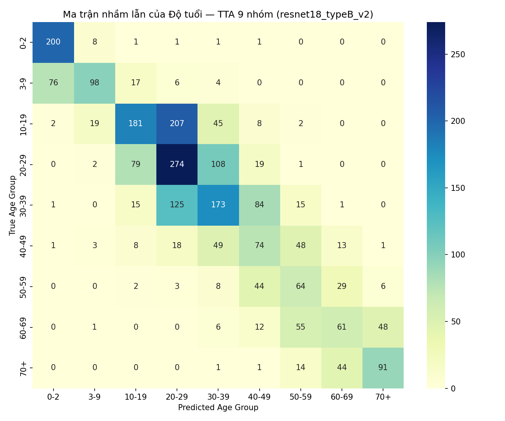
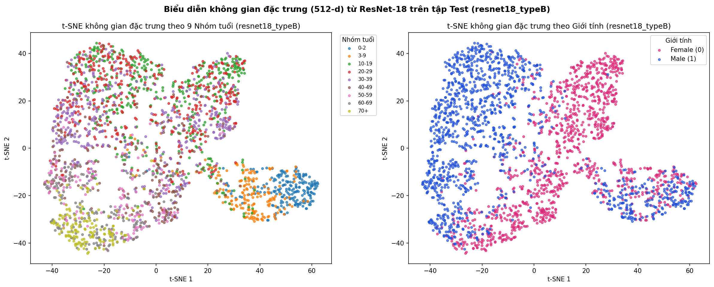
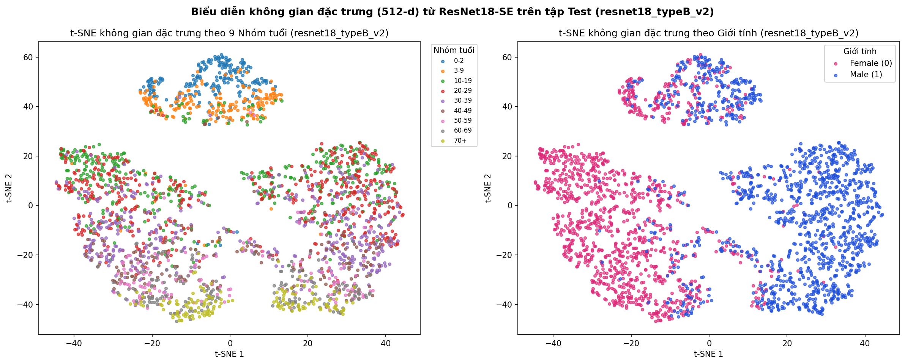

# Asian-Age-Gender: Dự đoán Nhóm Tuổi và Giới tính từ Ảnh Khuôn mặt Châu Á (Multi-task CNN)

Dự án học máy **huấn luyện hoàn toàn từ đầu (train from scratch, không sử dụng pretrained weights)** nhằm dự đoán đồng thời **Giới tính** (`Classification` — đầu ra **1 xác suất `Sigmoid` trong khoảng `(0, 1)`** hoặc chuỗi `[P(Female), P(Male)]`) và **Độ tuổi** (tiến hóa từ **Age Regression** sang **Multi-class 9 nhóm** và **CORAL Ordinal Regression + CBAM Multi-Scale** trên `0-2`, `3-9`, `10-19`, `20-29`, `30-39`, `40-49`, `50-59`, `60-69`, `70+`).

**Phạm vi dữ liệu:** Chỉ tập trung vào **nhóm sắc tộc Châu Á (Asian)** (`AFAD-Full`, `AAF`, `UTKFace[Asian]`, `FairFace[East Asian, Southeast Asian]`), không mở rộng sang các nhóm sắc tộc khác.

---

## 1. Cấu trúc Thư mục

```text
FINAL-PROJECT/
├── configs/
│   └── resnet18.yaml                  # Siêu tham số cho ResNet-18 (img_size: 224)
├── dataset/
│   ├── raw/                           # Dữ liệu gốc (UTKFace, AAF, FairFace)
│   ├── interim/                       # Dữ liệu trung gian (cleaned/, resized/)
│   ├── processed/                     # 16.522 ảnh Châu Á đã chia theo train/ val/ test/
│   │   ├── train/                     # <age_group>/<Female|Male>/ (11.565 ảnh)
│   │   ├── val/                       # <age_group>/<Female|Male>/ (2.478 ảnh)
│   │   └── test/                      # <age_group>/<Female|Male>/ (2.479 ảnh)
│   ├── external/                      # Dataset bổ sung ngoài (.gitkeep)
│   ├── metadata/                      # train.csv, val.csv, test.csv, split_info.csv, class_mapping.json, dataset_info.json, norm_stats.json, age_scaler.json
│   └── README.md                      # Mô tả chi tiết các dataset
├── notebooks/
│   ├── README.md                      # Hướng dẫn nhân bản template cho model mới
│   ├── 01_dataset_analysis.ipynb      # Phân tích dữ liệu hợp nhất, t-SNE, trực quan tiền xử lý & ZIP
│   └── resnet18/
│       ├── 02_train_eval_resnet18.ipynb               # Giai đoạn 0 / đồng bộ kiến trúc ResNet-18
│       ├── 02a_train_eval_resnet18_multiclass.ipynb   # Giai đoạn 1 (Kiểu A): Multi-class 9 lớp (CrossEntropy)
│       ├── 02b_train_eval_resnet18_coral.ipynb        # Giai đoạn 2 (Kiểu B): CORAL Ordinal 8 ngưỡng độc lập
│       ├── 02c_train_eval_resnet18_coral_v2.ipynb     # Giai đoạn 3 (Kiểu B+): ResNet18-SE + CORALLayer + Focal + TTA
│       ├── 02d_train_eval_resnet18_cbam_multiscale.ipynb # Giai đoạn 4 (Kiểu B++): Deep Stem + ResNet-D + CBAM + Multi-Scale
│       └── 03_visualize_trained_resnet18.ipynb        # Trực quan hóa lại kết quả từ checkpoint
├── train_results/
│   └── resnet18-base/21-11-2026/
│       ├── notebook/                  # Các notebook đã chạy thực nghiệm (02, 02a, 02b, 02c)
│       └── output/                    # Output thực nghiệm: history.csv, test_metrics.json, biểu đồ & checkpoints
├── src/
│   ├── datasets/                      # download_datasets.py, prepare_multidata.py, afad_dataset.py, transforms.py
│   ├── models/                        # builder.py (MODEL_REGISTRY), resnet18.py (SE, CBAM, DeepStem), multitask.py (CORALLayer)
│   ├── training/                      # train.py, engine.py, losses.py (MultiTaskLoss cho multiclass/coral/coral_v2/coral_v3)
│   ├── evaluation/                    # evaluate.py, metrics.py, visualize.py
│   └── utils/                         # seed.py, logger.py, checkpoint.py
├── checkpoints/                       # Lưu trọng số mô hình (.pth)
├── results/                           # Lưu biểu đồ EDA & kết quả chạy local
├── app.py                             # Demo Streamlit (hỗ trợ upload ảnh/URL + TTA, xuất P(Male) ∈ (0,1) & Nhóm tuổi)
├── train.py
├── evaluate.py
└── requirements.txt
```

---

## 2. Mô tả Từng Dataset Nguồn & Dữ liệu Sau khi Gộp

### 2.1. Mô tả 4 Bộ Dữ liệu Nguồn

| Dataset | Quy mô thô / Hợp lệ | Dải tuổi & Định dạng nhãn | Chủng tộc gốc | Vai trò & Cách xử lý khi gộp |
| :--- | :---: | :--- | :--- | :--- |
| **1. AFAD-Full** *(Asian Face Age Dataset)* | **165.501** ảnh | Tuổi liên tục `15–72` (`15–40` chiếm `99.35%`). Thư mục `<age>/<111\|112>/*.jpg` (`111=Male`, `112=Female`). | 100% **Asian** | Nguồn xương sống cho nhóm tuổi `15–40`; ảnh vuông sẵn (`median 94px`). Sau cân bằng giữ **8.318 ảnh**. |
| **2. AAF** *(All-Age-Faces)* | **13.322** ảnh (`aglined faces`) | Tuổi liên tục `2–80`. Tên file `%05dA%02d.jpg`: `ID <= 7380` → **Female (`0`)** (`7.381` ảnh), `ID > 7380` → **Male (`1`)** (`5.941` ảnh). | Chủ yếu **Asian** | Bổ sung ảnh khuôn mặt Châu Á đã căn chỉnh ở dải tuổi rộng (`2–80`) và có `identity_id` để chia tập chống rò rỉ. Sau cân bằng giữ **2.806 ảnh**. |
| **3. UTKFace** *(Aligned & Cropped)* | **23.708** ảnh thô (**23.705** hợp lệ) | Tuổi liên tục `0–116`. Tên file `[age]_[gender]_[race]_[date].jpg` (`gender: 0=Male, 1=Female`, `race: 0..4`). | Đa sắc tộc (`White, Black, Asian, Indian, Others`) | Chỉ lọc giữ **`race == "Asian"`** (loại 4 chủng tộc còn lại); bổ sung tốt trẻ em `<15` và người lớn tuổi. Sau lọc & cân bằng giữ **1.119 ảnh**. |
| **4. FairFace** *(WACV 2021, config `0.25`)* | **97.698** ảnh (`86.744` train + `10.954` val) | 9 nhóm tuổi chuỗi (`0-2` … `more than 70` → chuẩn hóa thành `70+`), `gender: Male/Female`. | 7 nhóm chủng tộc | Chỉ lọc giữ **`East Asian`** và **`Southeast Asian`**; quy đổi khoảng tuổi sang trung điểm (`1.0, 6.0, 14.5, ..., 75.0`) để cân bằng các nhóm tuổi hiếm (`0-2`, `3-9`, `50-69`, `70+`). Sau lọc & cân bằng giữ **4.279 ảnh**. |

### 2.2. Quá trình Làm sạch, Lọc Châu Á & Cân bằng (`Flexible Cap = 2.000`)
- **Tổng bản ghi thô từ 4 nguồn:** **300.226** ảnh → Kiểm tra ảnh hỏng (`Image.verify()`): loại **0** ảnh hỏng → Khử trùng lặp `MD5`: loại **1.220** ảnh trùng → Còn **299.006** ảnh sạch đa sắc tộc.
- **Lọc phạm vi Châu Á & Chuẩn hóa nhãn:**
  - Chỉ giữ nhóm sắc tộc Châu Á (`Asian`: **12.243**, `East Asian`: **2.214**, `Southeast Asian`: **2.065**).
  - Chuẩn hóa biến tuổi về **9 nhóm `age_group`** (`0-2`, `3-9`, `10-19`, `20-29`, `30-39`, `40-49`, `50-59`, `60-69`, `70+`).
  - Chuẩn hóa giới tính thống nhất toàn dự án: **`0 = Female (Nữ)`**, **`1 = Male (Nam)`**.
  - Áp dụng **Flexible Cap (`cap = 2.000`)** trên mỗi tổ hợp `(age_group, gender)`: giữ nguyên nhóm `< 2.000` và lấy mẫu ngẫu nhiên nhóm `> 2.000`.

### 2.3. Tổng hợp Dữ liệu Cuối cùng Sau khi Gộp (`16.522` ảnh Châu Á)
- **Tổng số ảnh sạch sau gộp & lọc Châu Á:** **16.522 ảnh**:
  - Theo nguồn: `AFAD-Full`: **8.318** (`50.35%`) | `FairFace`: **4.279** (`25.90%`) | `AAF`: **2.806** (`16.98%`) | `UTKFace`: **1.119** (`6.77%`).
  - Theo giới tính: **8.028 Female (`0`)** [`48.59%`] | **8.494 Male (`1`)** [`51.41%`] (tỷ lệ gần 1:1).
  - Dải tuổi số: `1.0 → 110.0` tuổi (trung bình tập Train: `30.80 ± 20.78`).

| Nhóm tuổi (`age_group`) | Trước lọc & Cap — Đa sắc tộc (Nữ / Nam / Tổng) | Sau lọc Châu Á & Cap (Nữ `0` / Nam `1` / Tổng) |
| :--- | :---: | :---: |
| `0-2` | 1.562 / 2.178 / 3.740 | 568 / 844 / **1.412** |
| `3-9` | 6.564 / 7.472 / 14.036 | 664 / 681 / **1.345** |
| `10-19` | 19.928 / 17.271 / 37.199 | 1.505 / 1.586 / **3.091** |
| `20-29` | 60.417 / 76.658 / 137.075 | 1.517 / 1.698 / **3.215** |
| `30-39` | 25.590 / 44.329 / 69.919 | 1.297 / 1.460 / **2.757** |
| `40-49` | 6.836 / 11.540 / 18.376 | 749 / 680 / **1.429** |
| `50-59` | 3.723 / 6.879 / 10.602 | 579 / 464 / **1.043** |
| `60-69` | 2.010 / 3.204 / 5.214 | 672 / 547 / **1.219** |
| `70+` | 1.411 / 1.434 / 2.845 | 477 / 534 / **1.011** |
| **Tổng cộng** | **128.041 / 170.965 / 299.006** | **8.028 / 8.494 / 16.522** |

### 2.4. Chia tập Chống rò rỉ (`70% / 15% / 15%`) & Thông số Chuẩn hóa (`224×224`)
- **Chia tập (`seed = 42`, group-aware theo `identity_id` / `md5`, kiểm tra trùng path & MD5 giữa 3 tập = 0):**
  - `Train`: **11.565** ảnh | `Validation`: **2.478** ảnh | `Test`: **2.479** ảnh.
- **Mean & Std tính trên tập Train (`224 × 224` RGB, [norm_stats.json](dataset/metadata/norm_stats.json)):**
  - `mean = [0.535029, 0.42123, 0.372826]`
  - `std  = [0.276233, 0.248417, 0.242609]`
- **Thông số chuẩn hóa tuổi ([age_scaler.json](dataset/metadata/age_scaler.json)):**
  - `train_age_mean = 30.8043`, `train_age_std = 20.7804`, `min = 1.0`, `max = 110.0`.
  - Z-score: `(age - 30.8043) / 20.7804` | Nghịch đảo: `age_norm * 20.7804 + 30.8043`.

### 2.5. Biểu đồ Trực quan hóa Dữ liệu & Tiền xử lý (`results/eda/`)
- **Phân bổ dữ liệu Giới tính & Độ tuổi (Trước vs Sau):** 
- **Biểu diễn t-SNE theo 9 Nhóm tuổi & Giới tính:** 
- **Ảnh sau Tiền xử lý Resize (`224×224`) & Geometric (`Flip + Rotate`):** 
- **Ảnh sau Chuẩn hóa (`Mean/Std`) & Data Augmentation:** 

---

## 3. Hướng dẫn Chạy nhanh

```bash
# 1. Cài đặt thư viện
pip install -r requirements.txt

# 2. Huấn luyện từ đầu bản mới nhất 02d (ResNet18-CBAM-MultiScale + Weighted CORAL, 40 epochs)
python train.py --model resnet18_cbam_ms --age-mode coral_v3 --epochs 40 --batch-size 64 --lr 1e-3 --img-size 224 --augment

# (Tùy chọn) Chạy lại Kiểu A (multiclass) hoặc Kiểu B (coral) hoặc Kiểu B+ (coral_v2)
# python train.py --model resnet18 --age-mode multiclass --epochs 30 --augment
# python train.py --model resnet18 --age-mode coral --epochs 30 --augment
# python train.py --model resnet18_se --age-mode coral_v2 --epochs 40 --augment

# 3. Đánh giá trên tập Test (bật TTA gốc + lật ngang)
python evaluate.py --model resnet18_cbam_ms --age-mode coral_v3 --checkpoint checkpoints/resnet18_cbam_ms_coral_v3_best.pth --img-size 224 --tta

# 4. Chạy Demo Streamlit (hỗ trợ tải file hoặc dán URL ảnh từ trên mạng)
streamlit run app.py
```

---

## 4. Tiến hóa Kiến trúc ResNet-18 qua từng Giai đoạn Notebook & Kết quả Thực nghiệm

Toàn bộ các phiên bản đều sử dụng chung tập dữ liệu Châu Á (`11,565` Train / `2,478` Val / `2,479` Test), chuẩn hóa theo `norm_stats.json`, cân bằng batch bằng `WeightedRandomSampler`, và **huấn luyện từ đầu (Kaiming Initialization)**.

### 4.1. Chi tiết Kiến trúc, Cải tiến, Lợi ích & Nhược điểm từng Giai đoạn

#### Giai đoạn 0 — Baseline Hồi quy Tuổi (`02`: Age Regression, 20 Epochs)
- **Kiến trúc:** `ResNet-18` chuẩn (`Conv 7×7 stride=2` + `4× BasicBlock [2,2,2,2]` + `GAP 512-d`, `11.18M` params) $\to$ `gender_head: Linear(512, 2)` (`CrossEntropy`) và `age_head: Linear(512, 1)` (`SmoothL1Loss`).
- **Augmentation:** `RandomHorizontalFlip`, `RandomRotation(15)`, `ColorJitter`.
- **Lợi ích:** Dự đoán ra số tuổi thực liên tục (`MAE_all = 6.52` năm, `MAE_exact_sources = 6.13` năm, `CS@5 = 55.34%`, `Gender Acc = 86.45%`).
- **Nhược điểm & Lý do phải cải tiến:**
  - Nguồn `FairFace` (`25.90%` dữ liệu) chỉ có nhãn 9 nhóm tuổi nên phải gán giả về trung điểm (`1.0, 6.0, 14.5, 24.5, ..., 75.0`), tạo nhiễu nhãn hồi quy.
  - Khi quy đổi kết quả dự đoán sang 9 nhóm tuổi, **Age-Group Exact Accuracy chỉ đạt `45.46%`** (nhầm nhiều ở vùng thanh niên–trung niên).

#### Giai đoạn 1 — Kiểu A (`02a`: Multi-class Classification 9 nhóm tuổi, 30 Epochs)
- **Thay đổi & Cải tiến:**
  - Chuyển bài toán Tuổi từ hồi quy số lẻ sang **phân loại 9 nhóm tuổi** (`0-2` … `70+`) khớp 100% nhãn gốc của `FairFace`, không còn phụ thuộc trung điểm giả.
  - Đổi `gender_head` sang **`Linear(512, 1)` $\to$ `Sigmoid`** (`BCEWithLogitsLoss + Label Smoothing α = 0.1`); `age_head` sang **`Linear(512, 9)` (`CrossEntropyLoss`)**, trọng số tổng `L = 1.0*L_gender + 3.0*L_age`.
  - Bổ sung Augmentation `RandomAffine` và `RandomErasing (p=0.25)` (tương đương *Coarse Dropout*) + kéo dài lịch học **30 epochs** + `Early Stopping`.
- **Lợi ích đạt được:** **Age-Group Exact Accuracy tăng vọt `+7.14%`** (từ `45.46%` $\to$ **`52.60%`**, `Macro F1 = 53.62%`), nhóm trẻ em `0-2` đạt `83.02%`, `3-9` đạt `83.58%`.
- **Nhược điểm & Lý do phải cải tiến:**
  - `CrossEntropyLoss` coi 9 nhóm tuổi là 9 lớp độc lập không có thứ tự, phạt nặng như nhau dù lệch 1 nhóm hay lệch 5 nhóm $\to$ vẫn xuất hiện lỗi nhảy cóc xa (vd `40-49` nhầm về `3-9`), `Age Adjacent (±1)` chỉ ở `89.27%`, và khoảng cách Train–Val nhánh Tuổi doãng rộng ở cuối (`66.5%` vs `54.7%`).
  - Nhánh Tuổi phân tách cứng làm cạnh tranh đặc trưng với Giới tính (`Gender Acc = 86.65%`, t-SNE chưa tách gọn).

#### Giai đoạn 2 — Kiểu B (`02b`: CORAL Ordinal Regression 8 ngưỡng, 30 Epochs)
- **Thay đổi & Cải tiến:**
  - Thay `age_head` từ `Linear(512, 9)` sang **`Linear(512, 8)`** với **CORAL Loss** — phân rã 9 nhóm tuổi thành **8 bài toán nhị phân có thứ tự** $P(\text{tuổi} > \text{nhóm } k)$ (`0` đến `7`), suy nhãn bằng điểm cắt trung vị $\sum \mathbb{I}(p_k > 0.5)$.
- **Lợi ích đạt được:**
  - **Age Adjacent Accuracy ($\pm 1$ nhóm) tăng lên `91.17%`** (triệt tiêu hầu hết lỗi nhảy cóc xa; `0-2`: `99.53%`, `3-9`: `95.52%`, `20-29`: `95.03%`, `70+`: `96.03%`).
  - Kéo **Gender Accuracy tăng `+1.41%`** lên **`88.06%`** (**`ROC-AUC = 95.38%`**) nhờ không gian đặc trưng `t-SNE` phân rã tự nhiên theo đúng hình thái lão hóa & giới tính.
- **Nhược điểm & Lý do phải cải tiến:**
  - Phân tích lỗi trên 2,479 ảnh Test cho thấy **2 điểm nghẽn chính ở tuổi thanh niên**: ngưỡng `> 10-19` chỉ đạt `83.42%` (`194` ca `10-19` đoán vống lên `20-29`) và ngưỡng `> 20-29` đạt `85.11%`.
  - Ảnh *in-the-wild* nền rối làm `Gender Acc` trên `FairFace` (`77.76%`) và `UTKFace` (`75.93%`) thấp hơn hẳn `AFAD-Full` (`95.03%`).
  - Dùng 8 đầu ra độc lập nên còn **`0.61%` ca vi phạm tính đơn điệu** ($p_{k+1} > p_k$), và `Val Age Loss` dao động răng cưa mạnh trong 11 epoch đầu do chưa có Warm-up & Gradient Clipping.

#### Giai đoạn 3 — Kiểu B+ (`02c`: `SE-Block` + Projection Heads + Shared `CORALLayer` + Focal + TTA, 40 Epochs)
- **Thay đổi & Cải tiến:**
  - Chèn **`SEBlock` (Squeeze-and-Excitation Attention)** vào mỗi `BasicBlock` (`11.53M` params).
  - Tách 2 **Projection Head riêng** (`512 -> 256 -> BN -> GELU -> Dropout(0.3)`) + **`CORALLayer` chuẩn** (1 trọng số chung $w^T h$ + 8 bias giảm dần nghiêm ngặt $b_0 > \dots > b_7$).
  - Áp dụng **Difficulty-Weighted Focal CORAL (`gamma = 1.5`)** nhấn mạnh ngưỡng `> 10-19` và `> 20-29`.
  - Ổn định huấn luyện **40 epochs** bằng **Linear Warm-up 3 epochs + CosineAnnealingLR + Gradient Clipping (`1.0`)**, đánh giá bằng **TTA (Ảnh gốc + Lật ngang)**.
- **Lợi ích đạt được:**
  - **Kỷ lục nhánh Giới tính: `89.55%` Accuracy (`F1 = 89.55%`, `ROC-AUC = 95.83%`)** — vượt cả mô hình `ResNet50 Pretrained ImageNet (88.76%)` trong báo cáo tham khảo dù nhẹ hơn một nửa!
  - Toàn bộ 4 nguồn dữ liệu đều tăng Gender Accuracy (`AFAD-Full`: `96.58%`, `FairFace`: `79.29%`, `UTKFace`: `78.40%`, `AAF`: `89.24%`).
  - Xóa sạch dao động răng cưa ở các epoch đầu (`Best Val Loss = 0.590` tại Epoch 38), **`0.00%` vi phạm đơn điệu CORAL**, và cho **biểu đồ t-SNE phân tách 3 vùng hoàn hảo** (Trẻ em `0-9` ở trên + 2 cột Nữ/Nam song song bên dưới chuyển tiếp mượt theo tuổi).
- **Nhược điểm & Lý do nâng cấp lên `02d`:**
  - **Focal Loss (`gamma = 1.5`)** tự co nhỏ gradient khi ngưỡng đạt `~0.84` khiến nhánh Tuổi bị *underfit* nhẹ (`Train Age Exact` dừng ở `51.6%`) và phân bố xác suất 9 nhóm bị bẹt ở đầu trẻ (`0-2` còn dư `~16%`).
  - **`CORALLayer` ép 1-D (`256 -> 1`)** quá chật khi học các ranh giới có đặc trưng khác nhau, làm `76` mẫu `3-9` trượt về `0-2` (`3-9` tụt từ `76.12%` $\to$ `48.76%`), khiến `Age Exact` chung hạ còn `49.05%`.

#### Giai đoạn 4 — Kiểu B++ (`02d`: Custom `ResNet-D Deep Stem` + `CBAM` + `Multi-Scale 768-d` + Weighted BCE, 40 Epochs — *Sẵn sàng chạy*)
- **2 bản sửa lỗi trực tiếp cho `02c`:**
  1. **Tắt Focal (`FOCAL_GAMMA = 0.0`):** Quay về **Weighted BCE chuẩn** (`[1.0, 1.0, 1.4, 1.4, 1.15, 1.0, 1.0, 1.0]`) để đẩy xác suất các ngưỡng dễ lên `0.98–0.99`, hết bẹt phân bố `0-2` và hết underfit.
  2. **Thay `CORALLayer` 1-D $\to$ `nn.Linear(256, 8)` + Phạt thứ tự mềm (`MONO_LAMBDA = 0.25`):** Giữ độ linh hoạt cho từng ranh giới tuổi (`3-9`, `10-19`, `60-69`) mà vẫn duy trì tính đơn điệu gần `0%`.
- **4 nâng cấp kiến trúc mới (`11.61M` params):**
  1. **`SEBlock` $\to$ `CBAM` (`Channel + Spatial Attention 7×7`):** Khoanh vùng mắt, mũi, miệng, đường hàm và bỏ qua nền rối trên `FairFace` / `UTKFace`.
  2. **Multi-Scale Feature Fusion (`layer3 + layer4`):** `gender_head` dùng `GAP(layer4)` (`512-d`); `age_head` ghép **`GAP(layer3) + GAP(layer4)` (`768-d`)** để nhìn cả kết cấu da/nếp nhăn mịn (`14×14`) lẫn hình khối tổng thể (`7×7`).
  3. **`ResNet-D Deep Stem` (`3× Conv 3×3` thay `Conv 7×7`) + `AvgPool2d` Shortcut:** Bảo toàn chi tiết da mảnh ngay từ đầu vào và không bỏ sót pixel khi downsample.
  4. **Giảm `RandomErasing (p=0.15)`** để tránh che mắt/miệng trên ảnh trẻ em `3-9` & `10-19`, kết hợp `Warm-up + GradClip + TTA`.

---

### 4.2. Bảng tổng hợp Chỉ số Đánh giá & Liên kết Toàn bộ File Output

| Giai đoạn | Notebook nguồn | Kết quả chính trên Tập Test (`2,479` ảnh) | Thư mục / File Output đã lưu |
| :--- | :--- | :--- | :--- |
| **GĐ 0: Baseline Regression** *(20 ep)* | [02_train_eval_resnet18.ipynb](train_results/resnet18-base/21-11-2026/notebook/02_train_eval_resnet18.ipynb) | `Gender Acc`: `86.45%` (`AUC 94.38%`)<br>`Age MAE`: `6.52` (`Exact sources 6.13`), `Age-Grp Acc`: `45.46%` | • [test_metrics.json](train_results/resnet18-base/21-11-2026/output/resnet18_outputs-20261121T043536Z-1-001/resnet18_outputs/results/resnet18/test_metrics.json)<br>• [history.csv](train_results/resnet18-base/21-11-2026/output/resnet18_outputs-20261121T043536Z-1-001/resnet18_outputs/results/resnet18/history.csv)<br>• [training_curves.png](train_results/resnet18-base/21-11-2026/output/resnet18_outputs-20261121T043536Z-1-001/resnet18_outputs/results/resnet18/training_curves.png) \| [test_evaluation_plots.png](train_results/resnet18-base/21-11-2026/output/resnet18_outputs-20261121T043536Z-1-001/resnet18_outputs/results/resnet18/test_evaluation_plots.png) |
| **GĐ 1: Kiểu A (`multiclass`)** *(30 ep)* | [02a_train_eval_resnet18_multiclass.ipynb](train_results/resnet18-base/21-11-2026/notebook/02a_train_eval_resnet18_multiclass.ipynb) | `Gender Acc`: `86.65%` (`AUC 94.24%`)<br>`Age Exact`: **`52.60%`** (`F1 53.62%`), `Adj±1`: `89.27%` | • [test_metrics.json](train_results/resnet18-base/21-11-2026/output/resnet18_typeA_outputs-20261121T100254Z-1-001/resnet18_typeA_outputs/results/resnet18_typeA/test_metrics.json) \| [history.csv](train_results/resnet18-base/21-11-2026/output/resnet18_typeA_outputs-20261121T100254Z-1-001/resnet18_typeA_outputs/results/resnet18_typeA/history.csv)<br>• [gender_age_loss_curves.png](train_results/resnet18-base/21-11-2026/output/resnet18_typeA_outputs-20261121T100254Z-1-001/resnet18_typeA_outputs/results/resnet18_typeA/gender_age_loss_curves.png) \| [gender_age_accuracy_curves.png](train_results/resnet18-base/21-11-2026/output/resnet18_typeA_outputs-20261121T100254Z-1-001/resnet18_typeA_outputs/results/resnet18_typeA/gender_age_accuracy_curves.png)<br>• [gender_confusion_matrix.png](train_results/resnet18-base/21-11-2026/output/resnet18_typeA_outputs-20261121T100254Z-1-001/resnet18_typeA_outputs/results/resnet18_typeA/gender_confusion_matrix.png) \| [age_confusion_matrix.png](train_results/resnet18-base/21-11-2026/output/resnet18_typeA_outputs-20261121T100254Z-1-001/resnet18_typeA_outputs/results/resnet18_typeA/age_confusion_matrix.png) \| [tsne_age_features.png](train_results/resnet18-base/21-11-2026/output/resnet18_typeA_outputs-20261121T100254Z-1-001/resnet18_typeA_outputs/results/resnet18_typeA/tsne_age_features.png) |
| **GĐ 2: Kiểu B (`coral`)** *(30 ep)* | [02b_train_eval_resnet18_coral.ipynb](train_results/resnet18-base/21-11-2026/notebook/02b_train_eval_resnet18_coral.ipynb) | `Gender Acc`: `88.06%` (`AUC 95.38%`)<br>`Age Exact`: `50.58%` (`F1 52.41%`), `Adj±1`: **`91.17%`** | • [test_metrics.json](train_results/resnet18-base/21-11-2026/output/resnet18_typeB_outputs-20261121T100334Z-1-001/resnet18_typeB_outputs/results/resnet18_typeB/test_metrics.json) \| [history.csv](train_results/resnet18-base/21-11-2026/output/resnet18_typeB_outputs-20261121T100334Z-1-001/resnet18_typeB_outputs/results/resnet18_typeB/history.csv)<br>• [gender_age_loss_curves.png](train_results/resnet18-base/21-11-2026/output/resnet18_typeB_outputs-20261121T100334Z-1-001/resnet18_typeB_outputs/results/resnet18_typeB/gender_age_loss_curves.png) \| [gender_age_accuracy_curves.png](train_results/resnet18-base/21-11-2026/output/resnet18_typeB_outputs-20261121T100334Z-1-001/resnet18_typeB_outputs/results/resnet18_typeB/gender_age_accuracy_curves.png)<br>• [gender_confusion_matrix.png](train_results/resnet18-base/21-11-2026/output/resnet18_typeB_outputs-20261121T100334Z-1-001/resnet18_typeB_outputs/results/resnet18_typeB/gender_confusion_matrix.png) \| [age_confusion_matrix.png](train_results/resnet18-base/21-11-2026/output/resnet18_typeB_outputs-20261121T100334Z-1-001/resnet18_typeB_outputs/results/resnet18_typeB/age_confusion_matrix.png) \| [tsne_age_features.png](train_results/resnet18-base/21-11-2026/output/resnet18_typeB_outputs-20261121T100334Z-1-001/resnet18_typeB_outputs/results/resnet18_typeB/tsne_age_features.png) |
| **GĐ 3: Kiểu B+ (`SE-CORAL v2 + TTA`)** *(40 ep)* | [02c_train_eval_resnet18_coral_v2.ipynb](train_results/resnet18-base/21-11-2026/notebook/02c_train_eval_resnet18_coral_v2.ipynb) | `Gender Acc`: **`89.55%`** (**`AUC 95.83%`**)<br>`Age Exact`: `49.05%`, `Adj±1`: `91.00%`, `Non-mono`: **`0.00%`** | • [test_metrics.json](train_results/resnet18-base/21-11-2026/output/resnet18_typeB_v2_outputs/results/resnet18_typeB_v2/test_metrics.json) \| [history.csv](train_results/resnet18-base/21-11-2026/output/resnet18_typeB_v2_outputs/results/resnet18_typeB_v2/history.csv)<br>• [gender_age_loss_curves.png](train_results/resnet18-base/21-11-2026/output/resnet18_typeB_v2_outputs/results/resnet18_typeB_v2/gender_age_loss_curves.png) \| [gender_age_accuracy_curves.png](train_results/resnet18-base/21-11-2026/output/resnet18_typeB_v2_outputs/results/resnet18_typeB_v2/gender_age_accuracy_curves.png)<br>• [gender_confusion_matrix.png](train_results/resnet18-base/21-11-2026/output/resnet18_typeB_v2_outputs/results/resnet18_typeB_v2/gender_confusion_matrix.png) \| [age_confusion_matrix.png](train_results/resnet18-base/21-11-2026/output/resnet18_typeB_v2_outputs/results/resnet18_typeB_v2/age_confusion_matrix.png) \| [tsne_age_features.png](train_results/resnet18-base/21-11-2026/output/resnet18_typeB_v2_outputs/results/resnet18_typeB_v2/tsne_age_features.png) |
| **GĐ 4: Kiểu B++ (`CBAM + Multi-Scale + ResNet-D`)** *(40 ep)* | [02d_train_eval_resnet18_cbam_multiscale.ipynb](notebooks/resnet18/02d_train_eval_resnet18_cbam_multiscale.ipynb) | *(Sẵn sàng chạy thực nghiệm — `11.61M` params)* | Xuất ra `results/resnet18_typeD_cbam_ms/` & `checkpoints/resnet18_typeD_cbam_ms_best.pth` |

#### Biểu đồ Trực quan Tiêu biểu (Kiểu B vs Kiểu B+)
- **Loss & Accuracy (`02c` — hội tụ mượt 40 Epochs):**
  
  
- **Ma trận nhầm lẫn Giới tính & Độ tuổi (`02c` TTA):**
  
  
- **Không gian đặc trưng t-SNE (`02b` vs `02c`):**
  
  

---

## 5. Hướng dẫn cho Thành viên nhóm khi Thêm Model mới
Xem hướng dẫn tại [notebooks/README.md](notebooks/README.md).
